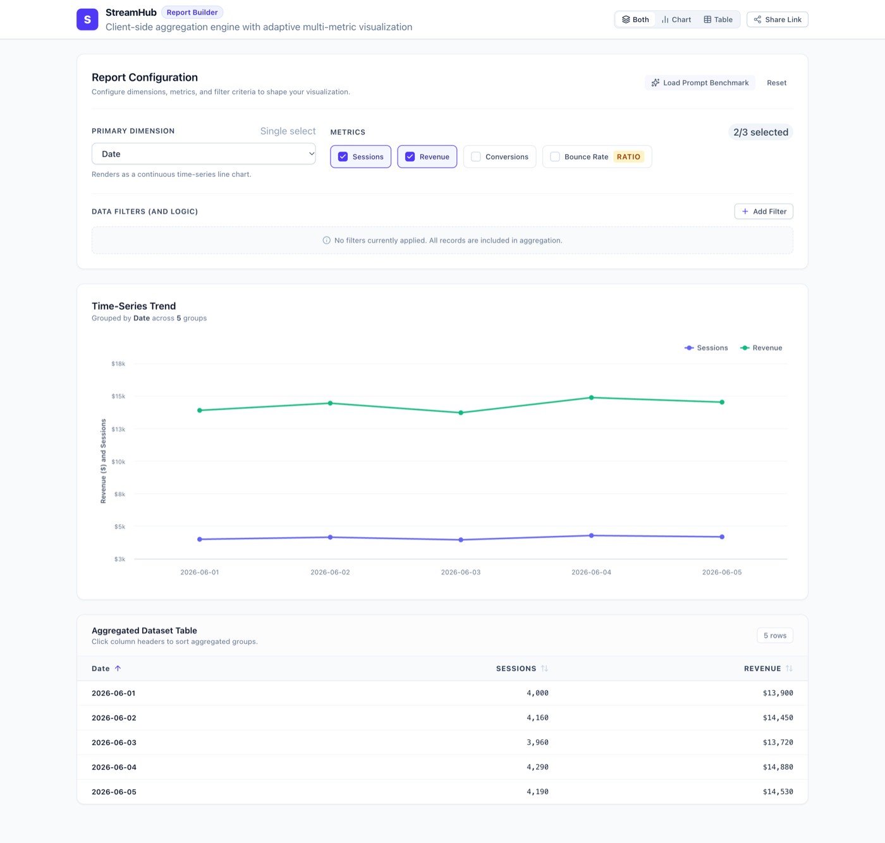

# SteamHub Report Builder

[](https://github.com/abhinavRai23/Streamhub-report/actions/workflows/deploy.yml)
&nbsp;**[🔗 Live Demo](https://abhinavrai23.github.io/Streamhub-report/)**

A high-performance, single-page analytics Report Builder built with **React 18**, **TypeScript**, **Zustand**, **TanStack Query**, **Tailwind CSS**, and **Highcharts**.

This project implements client-side aggregation, intelligent multi-axis charting, contextual filtering, URL-synced report state, and a sortable dataset table.



---

## Quick Start

### 1. Installation
```bash
npm install
```

### 2. Development Server
```bash
npm run dev
```
Open [http://localhost:5173](http://localhost:5173) in your browser.

### 3. Run Automated Tests
```bash
npm run test
```
Runs the full Vitest suite covering ratio metric correctness, multi-filter AND logic, date-range filtering, and Zustand store actions.

### 4. Production Build & Linting
```bash
npm run build    # Type-check with tsc -b and bundle with Vite
npm run lint     # Run oxlint across the codebase
```

---

## Core Features & Requirements

### 1. Configuration Panel
- **Primary Dimension Selector**: Single-select (`date`, `country`, `device`, `channel`, `campaign`).
  - Automatically toggles chart visualization between continuous time-series (line chart for `date`) and categorical breakdown (column/bar chart for other dimensions).
- **Metric Multi-Selector**: 1 to 3 metrics (`sessions`, `revenue`, `conversions`, `bounceRate`).
  - Enforces strict 1–3 metric selection constraint.
  - Highlights `bounceRate` with a special **Ratio Metric** tag.
- **Context-Aware Filters (AND Logic)**:
  - Supports `equals` and `not-equals` for categorical dimensions with preset value dropdowns (`US`, `UK`, `FR`, `DE`, `desktop`, `mobile`, etc.).
  - Supports `between` (date range) and `equals` for the `date` dimension with native date inputs.
  - Add, remove, update, and clear multiple filter criteria.
- **One-Click Benchmark Loader**:
  - Quickly loads the prompt's self-check configuration: `Country = US`, grouped by `device`.

### 2. The Ratio-Metric Aggregation Engine (`src/utils/dataEngine.ts`)
> **The Trap**: In real BI systems, ratio metrics like `bounceRate` must **never** be summed or naively averaged across rows ($\frac{\text{rate}_1 + \text{rate}_2}{2}$ is mathematically invalid due to Simpson's Paradox).

- **Implementation**: During client-side group reduction, raw components (`bounces` and `totalVisits`) are summed independently:
  $$\text{bounceRate}_{\text{group}} = \frac{\sum \text{bounces}}{\sum \text{totalVisits}}$$
- **Benchmark Verification**:
  Filtering `country = US` and grouping by `device`:
  - **Desktop**: 6,200 sessions / $24,780 revenue / **20.0% bounceRate** ($1,575 / 7,880$)
  - **Mobile**: 4,700 sessions / $14,100 revenue / **45.2% bounceRate** ($2,345 / 5,250$)
  - Directly verified by automated unit tests in `src/utils/dataEngine.test.ts`.

### 3. Adaptive Highcharts Visualization (`src/components/ChartView/ChartView.tsx`)
- **Dynamic Dual Y-Axis**:
  - If volumetric metrics (`revenue`, `sessions`, `conversions`) and ratio metrics (`bounceRate`) are selected together, the chart dynamically configures a primary axis for volume ($ / count) and an opposite secondary axis for bounce rate (0–100%).
  - If *only* `bounceRate` is selected, Axis 0 dynamically becomes the dedicated percentage axis (preventing empty/broken primary axes).
- **Custom HTML Tooltips**:
  - Currency formatted as `$24,780`, volume as `6,200`, and bounce rate formatted as percentage `20.0%`.
- **UX States**:
  - Empty state (when 0 metrics selected).
  - Animated skeleton placeholder during data resolution.
  - Retry-able error card when simulated API transient failure triggers.

### 4. Stretch Goals Implemented
1. **Sortable Data Table View (`src/components/TableView/TableView.tsx`)**:
   - Tabular presentation alongside the chart.
   - Column sorting by dimension or any selected metric with ascending/descending indicators.
2. **URL-Synced State (`src/hooks/useUrlSync.ts`)**:
   - Two-way synchronization with browser URL search parameters.
   - Includes `isHydratedRef` mount guard and a 250ms debounce timer to prevent browser history flooding.
   - Includes a "Share Link" button with instant clipboard feedback.

---

## Architectural Scaling Note: Extending to 50M Rows (Server-Side Aggregation)

*How this client-side architecture scales if the dataset were 50,000,000 rows instead of 25:*

```
[Browser Client] 
   │ 
   │ 1. POST /api/v1/analytics/query
   │    { dimension: "device", metrics: ["sessions", "revenue", "bounceRate"], filters: [...] }
   ▼
[API Gateway & Semantic Layer] (Node.js / Go)
   │ 
   │ 2. Compiles semantic metrics into Push-down SQL
   │    SELECT 
   │      device,
   │      SUM(sessions) AS sessions,
   │      SUM(revenue) AS revenue,
   │      SUM(bounces) / NULLIF(SUM(total_visits), 0) AS bounce_rate
   │    FROM fact_events
   │    WHERE country = 'US' AND event_date BETWEEN '2026-06-01' AND '2026-06-05'
   │    GROUP BY device
   ▼
[Columnar OLAP Engine] (ClickHouse / Snowflake)
   │
   │ 3. Executes in-memory vectorized columnar aggregation across partitions
   ▼
[Response Payload (~5-50 aggregated rows)] ──▶ [Browser Highcharts Client]
```

### Key Technical Pillars:
1. **Columnar OLAP Storage**: Store raw facts in ClickHouse, Apache Pinot, or Snowflake ordered by `(tenant_id, date, country, device)`. Columnar engines only read the specific columns queried (`bounces`, `total_visits`, `sessions`), skipping unneeded data.
2. **Push-down SQL Compilation**: The client never receives 50M raw rows. Instead, the frontend emits a structured query payload. The backend semantic layer compiles this into push-down SQL where ratio metrics are represented as expressions (`SUM(bounces) / NULLIF(SUM(total_visits), 0)`).
3. **Partition Pruning & Materialized Rollups**:
   - Date partitioning ensures queries for a 5-day range scan only the relevant partition blocks.
   - For ultra-high volume queries, maintain pre-aggregated rollup tables (e.g. ClickHouse `AggregatingMergeTree`) that pre-aggregate daily totals.
4. **TanStack Query Caching & Stale-While-Revalidate**:
   - Cache results on `[queryKey, dimension, metrics, hash(filters)]` with edge caching (Cloudflare / Fastly) so identical reports load in < 20ms.

---

## Project Structure

```
src/
├── api/
│   ├── mockData.json             # 25-row official StreamHub evaluation dataset
│   └── reportApi.ts              # Mock fetch wrapper (400ms delay, ~10% failure)
├── components/
│   ├── ChartView/
│   │   ├── ChartView.tsx         # Orchestrator
│   │   ├── ChartEmptyState.tsx   # Atomic empty state
│   │   ├── ChartSkeleton.tsx     # Atomic loading skeleton
│   │   ├── ChartErrorState.tsx   # Atomic retry error card
│   │   ├── HighchartsRenderer.tsx# Atomic chart renderer
│   │   └── useChartConfig.ts     # Multi-axis & options hook
│   ├── ConfigPanel/
│   │   ├── ConfigPanel.tsx       # Orchestrator
│   │   ├── ConfigPanelHeader.tsx # Header & benchmark actions
│   │   ├── DimensionSelector.tsx # Primary dimension picker
│   │   ├── MetricSelector.tsx    # Multi-select metric pills
│   │   ├── FilterSection.tsx     # Filter list manager
│   │   ├── FilterRow.tsx         # Contextual filter row
│   │   └── DateRangePicker.tsx   # Atomic date range input pair
│   ├── TableView/
│   │   ├── TableView.tsx         # Table container (Stretch Goal)
│   │   ├── TableHeader.tsx       # Sortable headers with indicators
│   │   └── TableRow.tsx          # Schema-formatted data cells
│   ├── Layout/
│   │   ├── AppHeader.tsx         # Top navigation & share link
│   │   └── ViewModeToggle.tsx    # View mode switcher (Both/Chart/Table)
│   └── UI/
│       ├── Button.tsx            # Accessible button primitive
│       ├── Select.tsx            # Generic type-safe select primitive
│       └── Skeleton.tsx          # Pulse skeleton loader
├── config/
│   └── reportSchema.ts           # Centralized Metric & Dimension registry
├── hooks/
│   └── useUrlSync.ts             # Bidirectional URL state sync with debouncing
├── store/
│   ├── useReportStore.ts         # Zustand state store
│   └── useReportStore.test.ts    # Store action unit tests
├── types/
│   └── report.ts                 # Discriminated union types for filters & models
├── utils/
│   ├── dataEngine.ts             # Filter logic & component-derived ratio aggregation
│   └── dataEngine.test.ts        # Unit test suite (prompt benchmark verification)
├── App.tsx                       # Root layout, QueryClient singleton, view switcher
├── main.tsx                      # App entry point
└── index.css                     # Tailwind CSS entry
```

---

## Accompanying Documentation
- [AI_NOTES.md](file:///Users/abhinavrai/Developer/SteamHub-ReportBuilder/AI_NOTES.md): Transparent record of AI tool usage, examples of rejected/corrected naive AI outputs (ratio metric averaging, React Query lifecycle), and time breakdown.
